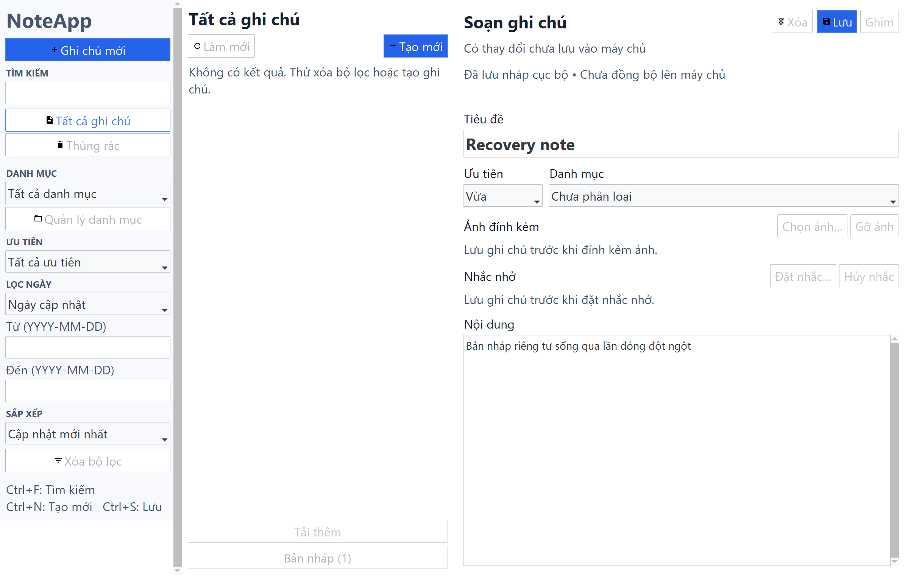

# R1-03 — FR-17 encrypted local draft recovery validation

Date: 2026-11-04. Branch: `feature/r1-03-draft-recovery`.
Base: `develop@925fbdf` after PR #16 (R1-02 merged).
Validated implementation: `9c3ca6e55e29611a3b599888bb248a6f044217e4`.
The documentation/evidence commit follows it. The [execution plan](../srs/r1/R1_PLAN_03_FR17_DRAFT_RECOVERY.md),
[contract](../srs/r1/03_R1_DRAFT_RECOVERY_CONTRACT_FREEZE.md) and
[ADR](../adr/ADR_R1_DRAFT_RECOVERY.md) remain proposed pending independent review.

Scope: FR-17/AC-17a..c, TC-REC-001..003, related FR-01/02, BR-09/10/14,
NFR-REL-01/02, NFR-SEC-04 and NFR-MAIN-01. Local validation does not approve an
OPEN business decision or complete the remote CI/reviewer release gates.

## Delivered behavior and files

| Commit | Group |
| --- | --- |
| `7dd272e` | Proposed contract, ADR and tracked execution plan |
| `3e3feed` | Draft DTO/ports, autosave/recovery services, key lifecycle, core tests |
| `d43ab3f` | Encrypted storage, atomic replacement, profile lease, storage contracts |
| `40f4f2b` | Mongo create retry guard for trashed notes |
| `5fa57e3` | Editor/local state, explicit recovery UI, worker lifecycle and component tests |
| `9c3ca6e` | Crash/restart desktop tests, fixture isolation and package/CI report gates |
| Following documentation commit | README/config sample, RTM, final report and recorded artifacts |

| Area | Changed files and responsibility |
| --- | --- |
| Application | `dto/local_draft.py`, `ports/draft_store.py`, `services/draft_autosave.py`, `draft_keys.py`, `draft_recovery.py`: immutable validated snapshots, monotonic revisions, key lifecycle, recovery classification, conditional ACK cleanup |
| Local adapters | `infrastructure/local/draft_paths.py`, `draft_serializers.py`, `encrypted_draft_store.py`, `profile_lock.py`: strict bounded format, existing R1-02 AES-GCM, encrypted temp/atomic replace, exclusive profile ownership |
| Configuration/composition | `infrastructure/config.py`, `bootstrap.py`: optional absolute draft profile, native OS secret store, injected services, worker cleanup |
| Mongo | `infrastructure/mongo/repositories.py`: an operation-ID retry for a trashed note conflicts instead of returning a false successful create acknowledgement |
| Presentation | `state/editor_state.py`, `state/sync_state.py`, `presenters/editor_presenter.py`, `draft_presenter.py`, `views/app_window.py`, `note_editor.py`, `recovery_dialog.py`: debounce, separate local/remote state, explicit recovery, stale-result protection, shutdown grace |
| Tests/CI | Shared fake/encrypted DraftStore contracts, core/model/key tests, presenter races, local file fault injection, real Tk component scenario, four added process/Mongo desktop scenarios; desktop report verifier now requires all 11 scenarios; installed-wheel smoke includes draft roundtrip |
| Documentation | Tracked R1-03 plan, contract, ADR, README, `.env.example`, RTM and this evidence set |

New drafts persist a stable `client_operation_id`; existing drafts persist `note_id`
and `base_version`. Recovery opens DIRTY/CONFLICT content, never remote SAVED. Only
a matching remote acknowledgement can delete the covered snapshot. Newer writes,
remote errors and conflicts keep local data. Discard requires explicit confirmation
and fences late worker writes for that draft identity.

The 750 ms debounce produces immutable snapshots for the existing bounded worker
pool. Local discovery runs independently from Mongo initialization. No worker calls
Tk or `root.after`; request/session checks reject stale results and callbacks after
close. Runtime waits for workers before releasing the profile lease in a worker.

Only opaque draft ID, format version and encrypted envelope appear in the file
wrapper. All text, operation ID, version, revision and timestamp fields are encrypted.
The master key is random 32-byte material acknowledged by the native SecretStore;
existing ciphertext with a missing key never causes replacement-key provisioning.
No plaintext file, temp, configured fixed key or file-based secret fallback exists.

## Executed checks

Windows 10.0.26100, Python **3.11.9**, cryptography **50.0.2**, keyring **25.7.0**,
MongoDB **7.0.43** in the existing loopback Docker instance. No new dependencies.
Use `.venv/Scripts/python.exe` for `python` below.

| Command | Actual result |
| --- | --- |
| `python -m ruff check .` | PASS |
| `python -m ruff format --check .` | PASS, 228 files |
| `python -m compileall -q src scripts` | PASS |
| `python -m pip check` | No broken requirements |
| `python scripts/verify_phase2_contract.py` | 5 declaration blocks, 10 models, 2 ports, 33 links verified |
| `python -m pytest -q tests/unit tests/contract tests/ui --junitxml=.pytest_cache/fr17-quality.xml --cov=noteapp.domain --cov=noteapp.application --cov=noteapp.infrastructure.local --cov-report=term --cov-report=json:.pytest_cache/fr17-coverage.json` | **576 passed, 1 skipped**, 69.19 s |
| `python -m pytest -q tests/integration --junitxml=.pytest_cache/fr17-integration.xml` with required Mongo/UI/native credential smoke | **218 passed**, no skips, 237.51 s |
| `python -m pytest -q tests/ui/test_draft_recovery_ui.py --junitxml=.pytest_cache/fr17-status-ui.xml` | **1 passed**, 2.12 s, after removing the contradictory memory-only status label |
| `python -m pytest -q tests/integration/test_desktop.py::test_r1_draft_recovers_after_restart_and_reconnects_without_duplicate --junitxml=.pytest_cache/fr17-status-desktop.xml` | **1 passed**, 8.82 s, after the status correction |
| `python scripts/verify_desktop_e2e.py docs/testing/R1_DRAFT_RECOVERY_DESKTOP_E2E.xml` | All **11** required scenarios passed; skipped=0 |
| `python -m pip wheel --no-deps --wheel-dir .pytest_cache/fr17-package .` | Built `noteapp-0.1.0-py3-none-any.whl` |
| `python scripts/verify_secure_storage_package.py .pytest_cache/fr17-package` | Installed-wheel security and draft recovery smoke PASS |
| `git diff --check` and staged checks before commits | PASS |

Integration environment:

```powershell
$env:NOTEAPP_TEST_MONGO_URI = "mongodb://127.0.0.1:27017"
$env:NOTEAPP_REQUIRE_MONGO = "1"
$env:NOTEAPP_REQUIRE_UI = "1"
$env:NOTEAPP_TEST_NATIVE_SECRET_STORE = "1"
$env:NOTEAPP_CAPTURE_RECOVERY_UI = "1"
python -m pytest -q tests/integration --junitxml=.pytest_cache/fr17-integration.xml
```

The one quality skip is the existing POSIX FIFO test in
`tests/unit/test_image_file_reader.py:43`, unsupported on Windows. No test was removed
or disabled. Combined domain/application/local statement coverage is **95%**:
1,566 statements, 76 missed. New LocalDraft is 94%, DraftAutosave 100%, DraftKeyProvider
97%, DraftRecoveryService 95%, encrypted store 85%, serializers 79%, profile lock 82%
and draft path selection 83%. Platform-specific and injected failure branches remain
uncovered; the percentages do not establish cross-platform acceptance.

## Acceptance evidence

| Case/invariant | Executed evidence |
| --- | --- |
| TC-REC-001 | Real encrypted file acknowledged, process terminates via `os._exit` without cleanup, a new Tk/Mongo process explicitly recovers while transport is unavailable, reconnects and saves; a third process verifies exactly one note |
| TC-REC-002 | Existing note advances remotely before restart; recovered local base remains stale, remote Save conflicts, both encrypted local and remote contents remain intact |
| TC-REC-003 | Native-store unavailable/denied, missing existing key and tampered ciphertext fail closed; warning hides provider/private markers; no plaintext fallback or silent regeneration |
| Lost remote ACK | Real Mongo create succeeds, injected transport failure loses its response; after process restart retry uses the persisted operation ID and leaves exactly one note |
| Remote deletion/trash | Application classification keeps the existing note identity; Mongo retry guard rejects a trashed operation-ID result, retaining the local draft |
| Atomic failure | Injected replace failure retains the prior acknowledged encrypted record; ordinary failed writes remove their encrypted temp |
| Revision races | Shared fake/file contracts exercise stale/same/new revisions, concurrent completion, ACK-before-first-write, newer-snapshot retention and discard fences |
| Key races/profile ownership | Concurrent providers acknowledge one key; second profile writer is rejected; process crash releases the native profile lease |
| UI lifecycle | ManualScheduler checks debounce without sleeps; real Tk verifies Mongo-down recovery, sanitized errors, late recovery after editing and closing while a worker is gated |
| Existing metadata | Recovery preserves missing category references; pin/image/reminder version adoption rebases draft metadata without replacing unsaved text |
| Packaging | A clean target installation imported with `python -I` performs real AEAD and encrypted file roundtrip, verifies plaintext absence and conditional cleanup |

The four recovery desktop scenarios use **real Tk, real Mongo and real AES/file
storage**, with a deterministic in-memory **test-only SecretStore** across subprocesses.
Transport outages and lost acknowledgements are injected at the NoteRepository port;
the shared Mongo service is never stopped. Native Windows Credential Manager
persistence/cleanup is tested separately by the opt-in native smoke and existing
production-bootstrap desktop scenarios. Synthetic test material has no production
bootstrap/configuration path.

Mongo fixtures own/drop only freshly generated `noteapp_test_*` databases. Native
credential cleanup removes only entries scoped to randomly owned fixture directories.
The optional `--no-build-isolation` rebuild attempt failed because this venv lacks
`bdist_wheel`; the required isolated `pip wheel` build and installed-wheel smoke
were used successfully instead. No runtime dependency change was needed.
The screenshot contains only synthetic test text:



[Evidence JSON](R1_DRAFT_RECOVERY_EVIDENCE.json) records the implementation SHA,
actual JUnit counts, source artifact hashes and wheel hash.
[Desktop JUnit](R1_DRAFT_RECOVERY_DESKTOP_E2E.xml) preserves the 11 actual testcase
elements extracted from the full integration result, without inventing outcomes.

## Limits, open gates and rollback

Python 3.10/3.12 interpreter execution, remote GitHub CI, native Linux Secret Service,
native macOS Keychain, independent QA/security review and M1/owner contract review
remain **NOT VERIFIED / PENDING**. Existing CI picks up these tests and the extended
11-scenario report/package gates; no remote run is claimed. FR-14 stays unimplemented.

Payload transport limit is 1 MiB serialized UTF-8 (wrapper reads at most 2 MiB).
Oversized data stays in RAM with a warning and can still use remote Save. Profile
locations/key names must remain stable. A lost OS credential cannot be reconstructed.
There is no background autosave after process exit, attachment binary recovery,
automatic conflict merge, cross-device key sync or automatic draft retention deletion.

Process-crash tests guarantee the last successful encrypted snapshot, not keystrokes
inside the debounce window. Temp flush/fsync plus same-directory replace protect
the old good record; directory metadata is not fsynced, and sudden power-loss
durability depends on the filesystem. Graceful close allows 1.5 s of UI polling;
already running native I/O can outlive that grace while runtime shuts down.

Rollback: stop the app, revert the grouped R1-03 commits in reverse order and
reinstall the preceding package. **Keep encrypted draft files and their OS keyring
entries** for later recovery; do not delete profiles/credentials or modify Mongo
records during rollback. No Mongo schema/index migration was introduced. Port/DTO
changes require M1 and affected owners to review before merge into `develop`.
